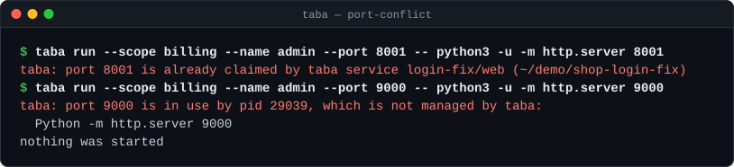

# taba

**Bundle what you start, per task.** *taba* (束) is Japanese for "bundle".


`taba` starts, lists and stops local processes such as dev servers, grouped by
the task they belong to. It gives you Docker-style `run / ps / logs / stop`
without containers. It's one binary, with no daemon and no config file.


## The problem

When you work with AI coding agents and several terminals, `localhost` ports
pile up. One task alone can leave three servers running. A few hours later,
nobody knows what is on `:5173`, which checkout it runs from, or whether it is
safe to kill. `taba` records the owner (a named **scope**) when a process
starts, so anyone can later see what belongs to which task and stop exactly
that task's processes.

## Install

`taba` is built from source with Rust and runs on macOS only. It has no
Homebrew formula or crates.io release yet.

```sh
git clone <this repo> taba && cd taba
cargo install --path .        # installs `taba` into ~/.cargo/bin
```

## Quick start

**Start services**, each owned by a scope and a name. `run` returns right away,
and the process keeps running after you close the terminal. Running the same
command a second time reuses the service that is already running and does not
start a copy.

```sh
taba run --scope login-fix --name web --port 5173 -- npm run dev -- --port 5173 --strictPort
```


> `--port` only tells taba which port to track. Pass the port to your own
> command as well.

**See what is running**, across every scope or for a single one:

```sh
taba ps                     # SERVICE / STATUS / URL / DIRECTORY
taba ps --scope billing     # one scope only
taba ps --json              # every field, for scripts and agents
```

**Port conflicts are reported before anything starts.** If the port is in use,
taba names the owner and starts nothing:



**Read logs.** stdout and stderr go to one log file per service:

```sh
taba logs billing/web       # print the log
taba logs billing/web -f    # follow it until the service exits
```


**Stop one service, or a whole task at once.** Services in other scopes keep
running:

```sh
taba stop billing/web
taba stop --scope billing
```


The screenshots show real output from `scripts/readme-screenshots.sh`, which
runs `python3 -m http.server` sample services under a throwaway `TABA_HOME`.

## Use with AI agents

taba is meant for AI coding agents as much as for people:

- **Set `TABA_SCOPE` once per task.** `run` uses it when `--scope` is omitted.
  `logs` and `stop` use it when you give a bare `NAME` instead of `SCOPE/NAME`.
  `stop` with no target always needs an explicit `--scope`.
- **Use `taba ps --json`** to find a service that is already running before
  starting another, and to read its URL, directory, pid and log path:

  ```console
  $ taba ps --scope login-fix --json
  [
    {
      "command": [
        "python3",
        "-u",
        "-m",
        "http.server",
        "8001"
      ],
      "directory": "/Users/Shared/demo/shop-login-fix",
      "log_path": "/Users/Shared/demo/taba-home/logs/login-fix/web.log",
      "name": "web",
      "pgid": 20081,
      "pid": 20081,
      "port": 8001,
      "scope": "login-fix",
      "service": "login-fix/web",
      "start_time": 1795501198411910,
      "status": "running",
      "url": "http://localhost:8001"
    }
  ]
  ```
- Each started process gets `TABA_SCOPE` and `TABA_SERVICE` in its environment.

### Agent skill

[`skills/taba/SKILL.md`](skills/taba/SKILL.md) is a skill in the Agent Skills
format. It tells an agent when and how to use taba: reuse before starting,
explicit ports, staying inside its own scope, and what to report at hand-off.
To install it, copy or symlink the `skills/taba` directory into a skills
folder your agent reads:

```sh
# Claude Code, for all projects
mkdir -p ~/.claude/skills && ln -s "$PWD/skills/taba" ~/.claude/skills/taba

# or for one project (Claude Code: .claude/skills, other agents: .agents/skills)
mkdir -p .claude/skills && cp -R /path/to/taba/skills/taba .claude/skills/
```

### AGENTS.md / CLAUDE.md snippet

If your agent doesn't load skills, paste this into `AGENTS.md` or `CLAUDE.md`:

```markdown
## Long-running processes (dev servers, watchers, databases)

- Start them with `taba run --scope <task> --name <name> --port <port> -- <cmd>`,
  never with `&` or `nohup`. Pass the same port to the command itself.
- Use one scope per task or branch (or `$TABA_SCOPE` if set).
- Before starting, run `taba ps --scope <task> --json` and reuse a service that
  is already running.
- If a port is taken, do not kill the other process. Pick another port or ask.
- Read output with `taba logs <task>/<name>`.
- Stop only your own scope: `taba stop --scope <task>`. Never stop other
  scopes or processes taba didn't start.
- At hand-off, report each service's name and URL, and say whether you left
  it running or stopped it.
```

## Ownership model

- **A scope owns its processes.** The owner is a named task, not the terminal
  or agent that started the process. Ownership survives closing the terminal.
- **taba stops only what it started and can still verify.** A service is
  signalled only if its identity still matches: the leader pid with its exact
  start time or, if the leader has exited, a surviving process group whose
  members all started after the recorded time. taba sends SIGTERM to the
  group, then SIGKILL after `--timeout` seconds (default 5).
- **Unmanaged processes are never touched.** A process taba didn't start, or
  one it can no longer verify, is reported, never signalled.
- **taba never deletes files.** Stopping a service leaves its record and log in
  place.
- **`run` is idempotent.** The same scope, name, command, directory and port
  returns the service that is already running. The same name with different
  settings is an error while the old service runs.

## Reference

### Commands

| Command | What it does |
| --- | --- |
| `taba run [--scope S] --name N [--port P] -- CMD...` | Start `CMD` detached as service `S/N`, in its own process group, with output appended to its log. |
| `taba ps [--scope S] [--json]` | List services with status `running` or `exited`, plus URL and directory. |
| `taba logs [-f] S/N` (or `N` with `$TABA_SCOPE`) | Print the log. Add `-f` to follow it until the service exits. |
| `taba stop S/N` (or `N` with `--scope` / `$TABA_SCOPE`) | Stop one service. |
| `taba stop --scope S` | Stop every service in scope `S`. |
| `taba stop ... --timeout SECS` | Seconds to wait between SIGTERM and SIGKILL (default 5). |

Run `taba <command> --help` to see all flags.

### Environment variables

| Variable | Meaning |
| --- | --- |
| `TABA_SCOPE` | Default scope for `run`, and for `logs` / `stop` when the target is a bare `NAME`. |
| `TABA_HOME` | State directory (default `~/.taba`). |
| `TABA_SCOPE`, `TABA_SERVICE` | Set *inside* each started process, so it knows its own scope and service. |

### State and logs

```text
$TABA_HOME (default ~/.taba)
├── services/<scope>/<name>.json   # command, directory, port, pid, pgid, start time, log path
├── logs/<scope>/<name>.log        # stdout + stderr, appended across runs
└── lock                           # serialises concurrent `run`s
```

## Limitations

taba is an early prototype:

- **macOS only.** It uses `proc_pidinfo` / `proc_listallpids`.
- **Port detection is partial.** taba checks loopback (IPv4/IPv6) connects and
  a wildcard bind. A server bound only to a non-loopback address may go
  unnoticed.
- **Exited entries are replaced on re-run.** A new `run` with the same
  scope/name overwrites the record of an exited service. The log is appended.
- **Some children are not tracked.** Children that move into a different
  process group or session are not tracked, and `stop` won't reach them.
- **No prune command.** Nothing removes exited records or rotates logs yet.

## Roadmap

- `prune` for exited records and old logs
- Linux support
- Better port detection (non-loopback binds)
- Prebuilt binaries and a Homebrew formula

See [docs/plan.md](docs/plan.md) for the design notes.
