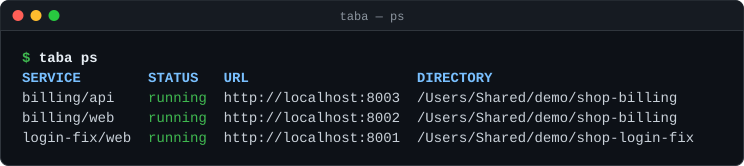
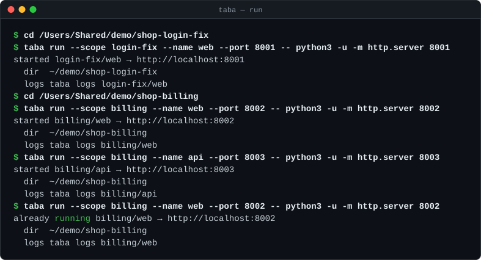
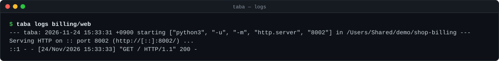
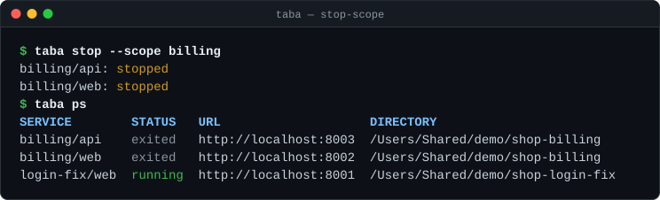
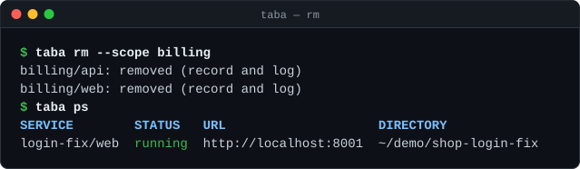

<h1>
  <picture>
    <source media="(prefers-color-scheme: dark)" srcset="docs/logo/taba-logo-dark.svg">
    <source media="(prefers-color-scheme: light)" srcset="docs/logo/taba-logo.svg">
    
  </picture>
</h1>

**Bundle what you start, per task.**


`taba` starts, lists and stops local processes such as dev servers, grouped by
the task they belong to. It gives you Docker-style `run / ps / logs / stop / rm`
without containers. It's one binary, with no daemon and no config file.



## The problem

When you work with AI coding agents and several terminals, `localhost` ports
pile up. One task alone can leave three servers running. A few hours later,
nobody knows what is on `:5173`, which checkout it runs from, or whether it is
safe to kill. `taba` records the owner (a **scope**: by default the git
worktree you run it in) when a process starts, so anyone can later see what
belongs to which task, and only that task can stop its processes.

## Install

`taba` is built from source with Rust and runs on macOS, Linux and Windows
(see [Platforms](#platforms)). It has no Homebrew formula or crates.io
release yet.

```sh
git clone <this repo> taba && cd taba
cargo install --path .        # installs `taba` into ~/.cargo/bin
```

## Quick start

**Start services**, each owned by a scope and a name. `run` returns right away,
and the process keeps running after you close the terminal. Running the same
command a second time reuses the service that is already running and does not
start a copy.

```sh
# Inside a git worktree, the worktree is the scope: no --scope needed.
taba run --name web --port auto --wait -- npm run dev -- --port {port} --strictPort
# started login-fix-3f9a/web → http://localhost:4100
#   ...
#   ready tcp check passed in 840 ms

# Or name the scope and the port yourself.
taba run --scope login-fix --name web --port 5173 -- npm run dev -- --port {port} --strictPort
```



- **`--port auto`** picks the lowest free port in 4100–4999 (`--port auto:5173`
  starts the search at 5173). The choice is recorded before taba lets go of
  its lock, so parallel runs never get the same port.
- **taba hands the port to the app** in two ways: it replaces every `{port}`
  in the command, and it sets `PORT` in the app's environment. With
  `--port auto` and no `{port}` in the command, taba warns that the app may
  ignore `PORT`.
- **`--wait[=SECS]`** (default 30 s) returns only once the service is ready:
  its port accepts connections (`--ready tcp`, the default), an HTTP request
  answers below 500 (`--ready http:/health`), or a log line matches
  (`--ready 'log:listening on'`). If the process exits first, `run` fails
  with the end of its log. If the time runs out, `run` fails and leaves the
  process running, so you can read its log.

**What `taba run` does.** It wraps the command you already use, such as
`npm run dev`. It starts it detached in its own process group, records the
scope, name, directory and port, sends stdout and stderr to a log file, and
gives you the prompt back. The server itself runs unchanged.

| | `npm run dev` | `taba run … -- npm run dev` |
| --- | --- | --- |
| Terminal | busy until you press Ctrl-C | free again right away |
| Close the terminal | the server stops | the server keeps running |
| Output | in that terminal only | in a log file, `taba logs` from any terminal |
| Later | find it with `ps` / `lsof` | `taba ps` shows task, URL and directory |

**Check where you are.** `taba whoami` prints the scope taba would use here
and where it comes from (`--scope`, `$TABA_SCOPE`, or the git worktree), the
branch, and the scope's services:

```sh
taba whoami          # scope login-fix-3f9a (from git), worktree, branch, agent, services
```

**See what is running**, across every scope or for a single one:

```sh
taba ps                     # SERVICE / STATUS / URL / DIRECTORY (running and exited)
taba ps --running           # running services only
taba ps --scope billing     # one scope only
taba ps --json              # every field with absolute paths, for scripts and agents
```

**Port conflicts are reported before anything starts.** If the port is in use,
taba names the owner (with its command line, for a process taba didn't start),
starts nothing, and suggests `--port auto`. It never offers to kill the
holder:


**Read logs.** stdout and stderr go to one log file per service:

```sh
taba logs billing/web       # print the log
taba logs billing/web -f    # follow it until the service exits
```



**Stop one service, or a whole task at once.** Services in other scopes keep
running:

```sh
taba stop web                 # in the service's worktree (or with $TABA_SCOPE)
taba stop --scope billing     # every service of scope billing
```

**Only the owner stops a service.** `stop` and `rm` refuse a service of
another scope with `E_NOT_OWNER`, also for a person in a terminal with no
scope at all. To override, give a reason; it is appended to
`$TABA_HOME/events.jsonl` with who, where and why:

```sh
taba stop billing/web                                    # from elsewhere: refused (exit 3)
taba stop billing/web --force --reason "stuck since lunch"
```



**Clean up when the task is done.** Stopped services stay in `ps` so you can
still read their logs. `rm` deletes their records and logs, and refuses
services that are still running:

```sh
taba rm billing/web
taba rm --scope billing
```



The screenshots show real output from `scripts/readme-screenshots.sh`, which
runs `python3 -m http.server` sample services under a throwaway `TABA_HOME`.

## Use with AI agents

taba is meant for AI coding agents as much as for people:

- **Start servers with `run --port auto --wait --json`.** The agent never
  invents a port, and the reply says when the server is ready and where:

  ```console
  $ taba run --name web --port auto --wait --json -- npm run dev -- --port {port} --strictPort
  {
    "ok": true,
    "status": "started",
    "service": "login-fix-3f9a/web",
    "url": "http://localhost:4100",
    "port": 4100,
    "ready": { "check": "tcp", "ms": 840 },
    ...
  }
  ```

  Running the same command again returns `"status": "already_running"` with
  the same URL, so it is safe to repeat.
- **Each worktree is its own scope.** Agents in separate git worktrees get
  separate scopes without configuring anything, and successive agents in one
  worktree share its services. `$TABA_SCOPE` or `--scope` still override
  this, for orchestrators that want task-named scopes. Run `taba whoami` to
  see which scope applies.
- **Errors are machine-readable.** With `--json` (or `TABA_OUTPUT=json`),
  `run`, `stop` and `whoami` print one JSON document for success and
  failure. A failure has `error.code`, `error.message`, `error.details` and
  `error.next`, a list of allowed next steps, most preferred first. `next`
  never suggests `kill` or `--force`; when only a person can resolve the
  error, it ends with "ask the human". See [Errors](#errors).
- **Use `taba ps --json`** to find a service that is already running before
  starting another, and to read its URL, directory, pid and log path:

  ```console
  $ taba ps --scope login-fix --json
  [
    {
      "service": "login-fix/web",
      "scope": "login-fix",
      "name": "web",
      "status": "running",
      "url": "http://localhost:8001",
      "port": 8001,
      "directory": "/Users/Shared/demo/shop-login-fix",
      "command": [
        "python3",
        "-u",
        "-m",
        "http.server",
        "8001"
      ],
      "pid": 72306,
      "pgid": 72306,
      "start_time": 1795509874101287,
      "log_path": "/Users/Shared/demo/taba-home/logs/login-fix/web.log",
      "instance": "72306-1795509874101287"
    }
  ]
  ```
- Each started process gets `TABA_SCOPE` and `TABA_SERVICE` in its environment.

### Agent skill

[`skills/taba/SKILL.md`](skills/taba/SKILL.md) is a skill in the Agent Skills
format. It tells an agent when and how to use taba: reuse before starting,
`--port auto --wait --json`, reading `error.next`, staying inside its own
scope, and what to report at hand-off.
To install it, copy or symlink the `skills/taba` directory into a skills
folder your agent reads:

```sh
# Claude Code, for all projects
mkdir -p ~/.claude/skills && ln -s "$PWD/skills/taba" ~/.claude/skills/taba

# or for one project (Claude Code: .claude/skills, other agents: .agents/skills)
mkdir -p .claude/skills && cp -R /path/to/taba/skills/taba .claude/skills/
```

### AGENTS.md / CLAUDE.md snippet

If your agent doesn't load skills, paste this into `AGENTS.md` or `CLAUDE.md`:

```markdown
## Long-running processes (dev servers, watchers, databases)

- Start them with
  `taba run --name <name> --port auto --wait --json -- <cmd with {port}>`,
  never with `&` or `nohup`, and use the `url` from the reply. Never invent a
  port.
- The git worktree you work in is your scope (`taba whoami` shows it). If
  `$TABA_SCOPE` is set, it wins.
- Before starting, run `taba ps --scope <scope> --json` and reuse a service
  that is already running.
- On an error, read `error.code` and do the first item of `error.next`. Never
  answer `E_PORT_IN_USE` or `E_NOT_OWNER` with `kill`, `pkill` or `--force`.
- Read output with `taba logs <name>`.
- Stop only your own scope: `taba stop --scope <scope>`, then clean up with
  `taba rm --scope <scope>`. Never touch other scopes or processes taba
  didn't start.
- At hand-off, report each service's name and URL, and say whether you left
  it running or stopped it.
```

## How taba compares

taba's peers are local process managers, not Docker. Tested 2026-11-24 on
macOS. Method, sources and the full table are in
[docs/comparison.md](docs/comparison.md).

| | taba | pm2 | overmind / foreman | process-compose | mprocs (now dekit) |
| --- | --- | --- | --- | --- | --- |
| Background process it needs | none | a daemon | overmind + tmux with `-D`; foreman is foreground only | a server per project | a runner per project |
| Start one command, no config file | yes | yes | no, needs a Procfile | no, needs a YAML file | yes (`dekit spawn`, inside a project) |
| Same start command twice | reuses the running one | a copy or an error, depending on how you start it | error (overmind) | reports success, then fails on its API port | error |
| Port already in use | refuses and names the holder | crash-loops | the process exits | the process exits | the process exits |
| Restarts, TUI, Linux | none of these | all three | overmind: restarts and Linux; foreman: Linux | all three | all three (restarts only for tasks in `dekit.yaml`) |

taba is the small option: no daemon and no config, and it is safe to run again,
for dev servers spread over many tasks and checkouts on one Mac. If you need
restarts, dependencies, a TUI or Linux, use process-compose, dekit or pm2.

## When to use Docker instead

taba does not isolate processes or make environments reproducible. A service
is an ordinary host process using whatever is on your `PATH`. Use Docker for
that. Measurements against Docker are in [docs/benchmarks.md](docs/benchmarks.md).

## Ownership model

- **A scope owns its processes.** The owner is a task, not the terminal or
  agent that started the process. By default it is the git worktree folder
  (`<folder>-<hash4>`; the branch is not part of it), else `$TABA_SCOPE` or
  `--scope`. Ownership survives closing the terminal.
- **Only the owner stops or removes.** `stop` and `rm` of another scope's
  service are refused with `E_NOT_OWNER`, for agents and people alike.
  `--force --reason TEXT` is the only override, and every use is recorded in
  `events.jsonl`.
- **One change per service at a time.** A `stop`, and a `run` until its
  service is ready, hold a per-service operation lock. A second `stop` of
  the same service gets `E_BUSY` instead of signalling it again.
- **taba stops only what it started and can still verify.** A service is
  signalled only if its identity still matches: the leader pid with its exact
  start time or, if the leader has exited, a surviving process group whose
  members all started after the recorded time. taba sends SIGTERM to the
  group, then SIGKILL after `--timeout` seconds (default 5). On Windows the
  group is a Job Object, and taba sends Ctrl+Break, then terminates the job.
- **Unmanaged processes are never touched.** A process taba didn't start, or
  one it can no longer verify, is reported, never signalled.
- **Stopping never deletes files.** A stopped service keeps its record and log
  until you run `taba rm`. `rm` deletes only stopped services' records and
  logs, and only inside `$TABA_HOME`.
- **`run` is idempotent.** The same scope, name, command, directory and port
  returns the service that is already running. The same name with different
  settings is an error while the old service runs.

## Reference

### Commands

| Command | What it does |
| --- | --- |
| `taba run [--scope S] --name N [--port P \| auto \| auto:START] [--wait[=SECS]] [--ready CHECK] [--json] -- CMD...` | Start `CMD` detached as service `S/N`, in its own process group, with output appended to its log. `{port}` in `CMD` is replaced by the port, and `PORT` is set. |
| `taba whoami [--scope S] [--json]` | Show the scope taba uses here, its source (`flag`, `env`, `git`), worktree, branch, agent and services. |
| `taba ps [--scope S] [--running] [--json]` | List services with status `running`, `starting`, `stopping` or `exited`, plus URL and directory (`~` for your home; absolute in `--json`). `--running` hides exited ones. |
| `taba logs [-f] S/N` (or `N` in your scope) | Print the log. Add `-f` to follow it until the service exits. |
| `taba stop S/N` (or `N` in your scope) | Stop one service of your own scope. |
| `taba stop --scope S` | Stop every service in scope `S`. |
| `taba stop ... --timeout SECS` | Seconds to wait between SIGTERM and SIGKILL (Windows: Ctrl+Break and job termination; default 5). |
| `taba stop ... --force --reason TEXT` | Stop a service of another scope; recorded in `events.jsonl`. |
| `taba rm S/N` (or `N` in your scope) | Delete a stopped service's record and log. Refuses a running service, and another scope's service without `--force --reason`. |
| `taba rm --scope S` | Delete the records and logs of every stopped service in scope `S`; running ones are kept and reported. |

`--ready` is `tcp` (default when there is a port), `http:PATH` or
`log:REGEX`, and needs `--wait`. `--agent NAME` on `run`, `stop`, `rm` and
`whoami` overrides `$TABA_AGENT`. Run `taba <command> --help` to see all
flags.

### Errors

With `--json` or `TABA_OUTPUT=json`, `run`, `stop` and `whoami` print
`{"ok": true, ..., "warnings": [...]}` or
`{"ok": false, "error": {"code", "message", "details", "next"}, ...}`.
Without it, the message and the next steps go to stderr. The exit status
follows the code:

| Code | Exit | Meaning |
| --- | --- | --- |
| `E_USAGE`, `E_INVALID_IDENT`, `E_FORCE_NEEDS_REASON` | 2 | Bad flags or names; `--force` without `--reason`. |
| `E_NO_SCOPE` | 2 | No `--scope`, no `$TABA_SCOPE`, and not inside a git worktree. |
| `E_NOT_OWNER` | 3 | The service belongs to another scope. |
| `E_BUSY` | 3 | Another `stop` or starting `run` of that service is in progress. |
| `E_CONFLICT` | 3 | Same name already running with a different command, directory or port. |
| `E_STILL_RUNNING` | 3 | `rm` of a running service. |
| `E_PORT_IN_USE`, `E_PORT_CLAIMED` | 4 | The port is held by a process, or reserved by another taba service. |
| `E_NO_FREE_PORT` | 4 | `--port auto` found no free port in its range. |
| `E_START_FAILED` | 4 | The process exited before it was ready; `details.log_tail` has its last lines. |
| `E_NOT_READY` | 4 | `--wait` timed out; the process is still running. |
| `E_NOT_FOUND` | 5 | No such service. |
| `E_STATE`, `E_SIGNAL_FAILED` | 1 | State directory unreadable or too new; a signal failed. |

`stop --scope` reports each service in `results` (`stopped`, `killed`,
`not_running`, or `refused` with its error) and exits 3 if any was refused.

### Environment variables

| Variable | Meaning |
| --- | --- |
| `TABA_SCOPE` | The caller's scope when `--scope` is not given; beats the git worktree. |
| `TABA_AGENT` | Name of the acting agent, recorded with services and `--force` events (default `human`). |
| `TABA_OUTPUT` | `json` makes `run`, `stop`, `whoami` and `ps` print JSON. |
| `TABA_HOME` | State directory (default `~/.taba`). |
| `TABA_SCOPE`, `TABA_SERVICE`, `PORT` | Set *inside* each started process: its scope, its service name and (with `--port`) its port. |

### State and logs

```text
$TABA_HOME (default ~/.taba)
├── services/<scope>/<name>.json   # command, directory, port, pid, pgid, start time, log path, instance
├── logs/<scope>/<name>.log        # stdout + stderr, appended across runs
├── ops/<scope>/<name>.json        # in-flight stop or start of that service (operation lock)
├── events.jsonl                   # audit log of --force overrides
├── version                        # state schema version (2)
└── lock                           # serialises changes to the state
```

State written by taba 0.1 is read unchanged.

## Platforms

taba runs on macOS, Linux and Windows, and CI tests all three. Output,
JSON fields and error codes are the same everywhere; how taba tracks and
stops processes differs:

| | macOS | Linux | Windows |
| --- | --- | --- | --- |
| Process facts | `proc_pidinfo`, `KERN_PROCARGS2` | `/proc/PID/stat`, `cmdline` | `GetProcessTimes`, the process's command line |
| Listening ports | `lsof` | `/proc/net/tcp{,6}` | `GetExtendedTcpTable` |
| A service's processes | its process group (new session) | its process group (new session) | its Job Object |
| `stop` | SIGTERM, then SIGKILL | SIGTERM, then SIGKILL | Ctrl+Break, then terminate the job |
| State lock | `flock` | `flock` | `LockFileEx` |

On Windows:

- A service runs with its own hidden console, so closing the terminal that
  started it does not stop it. If that terminal runs its children in a job
  that kills them on close and forbids breakaway, the service is still part
  of that job and stops with it.
- `stop`'s graceful step is Ctrl+Break, which most runtimes (Node, Python,
  Go) treat as SIGBREAK and exit on. JSON keeps `"signal": "TERM"` /
  `"KILL"` for the two steps.
- Programs are looked up with `PATHEXT`, so `taba run -- npm run dev` runs
  `npm.cmd`.
- `python3` is often only the Microsoft Store stub; use `python`.
- Paths print as `C:\...`, with `~` for `%USERPROFILE%`, and `next`
  commands are quoted for POSIX shells (Git Bash, WSL).

### WSL and Windows

A server in WSL and one on Windows live in separate process spaces. taba
inside WSL sees only WSL processes, and taba on Windows only Windows ones;
neither can stop the other's servers, and each keeps its own `~/.taba`.

Ports are another matter: WSL forwards `localhost` ports to Windows (and
in mirrored networking mode, both ways). A port used by a WSL server
therefore looks taken from Windows, but its process is not visible there.
taba on Windows reports such a port as `E_PORT_IN_USE` with
`holder.kind: "unknown"`, saying it is forwarded from WSL (`wslrelay.exe`)
or held by a process it cannot see, which may run outside this OS (WSL, a
VM or a container). `--port auto` skips such ports. Run `taba ps` inside
WSL to see what holds it there.

## Limitations

taba is an early prototype:

- **Port detection is partial.** taba checks loopback (IPv4/IPv6) connects and
  a wildcard bind. A server bound only to a non-loopback address may go
  unnoticed.
- **Exited entries are replaced on re-run.** A new `run` with the same
  scope/name overwrites the record of an exited service. The log is appended.
- **Some children are not tracked.** Children that move into a different
  process group or session (Windows: break away from the job) are not
  tracked, and `stop` won't reach them.
- **No log rotation.** Logs grow across runs until you `taba rm` the service.
- **Ownership is a convention, not security.** `--scope`, `$TABA_SCOPE` and
  `$TABA_AGENT` are claims: any process of your user can name any scope, and
  `taba stop --scope S` acts as `S`. The rules prevent accidents between
  cooperating agents, not deliberate misuse. Agent leases, which tell a live
  holder of a scope from its successor, come in a later milestone.

## Roadmap

- The rest of [design v0.2](docs/design-v0.2.md): JSON for every command and
  `ps --all` (M2), agent leases and `gc` (M3), borrows of another scope's
  service (M4), hand-over with `move` (M5), agent hooks (M6)
- Log rotation
- Better port detection (non-loopback binds)
- Prebuilt binaries and a Homebrew formula

See [docs/design-v0.2.md](docs/design-v0.2.md) for the current design and
[docs/plan.md](docs/plan.md) for v0.1.

## License

MIT, see [LICENSE](LICENSE).
