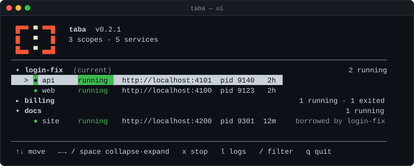

<h1>
  <picture>
    <source media="(prefers-color-scheme: dark)" srcset="docs/logo/taba-logo-dark.svg">
    <source media="(prefers-color-scheme: light)" srcset="docs/logo/taba-logo.svg">
    
  </picture>
</h1>

**Bundle what you start, per task.**


`taba` starts, lists and stops local processes such as dev servers, grouped by
the task they belong to. It gives you Docker-style `run / ps / logs / stop / rm`
without containers. It's one binary, with no daemon and no config file.


## The problem

When you work with AI coding agents and several terminals, `localhost` ports
pile up. One task alone can leave three servers running. A few hours later,
nobody knows what is on `:5173`, which checkout it runs from, or whether it is
safe to kill. `taba` records the owner (a **scope**: by default the git
worktree you run it in) when a process starts, so anyone can later see what
belongs to which task, and only that task can stop its processes.

## Install

Download an archive and `SHA256SUMS` from [GitHub Releases](https://github.com/Buchi-dev-dzn/taba/releases). Pick the archive for your OS and CPU:

| Platform | v0.2.4 archive |
| --- | --- |
| macOS Apple Silicon | `taba-v0.2.4-aarch64-apple-darwin.tar.gz` |
| macOS Intel | `taba-v0.2.4-x86_64-apple-darwin.tar.gz` |
| Windows x86_64 | `taba-v0.2.4-x86_64-pc-windows-msvc.zip` |
| Linux x86_64 (GNU/glibc) | `taba-v0.2.4-x86_64-unknown-linux-gnu.tar.gz` |
| Linux arm64 (GNU/glibc) | `taba-v0.2.4-aarch64-unknown-linux-gnu.tar.gz` |

Compare the archive's SHA-256 with the matching line in `SHA256SUMS`: use
`shasum -a 256 FILE` on macOS, `sha256sum FILE` on Linux, or
`Get-FileHash FILE -Algorithm SHA256` in PowerShell. Extract the archive, put
`taba` (`taba.exe` on Windows) somewhere on `PATH`, and run `taba --version`.
Linux binaries are built on Ubuntu 22.04 (x86_64) and 24.04 (arm64); use a
source build if your system has an older glibc or uses musl.

Releases follow [docs/releasing.md](docs/releasing.md): fixes and
backward-compatible additions ship as 0.2.x patches, and only breaking changes
bump the minor version.

To build the released version from Git with Rust and Cargo:

```sh
cargo install --locked --git https://github.com/Buchi-dev-dzn/taba.git --tag v0.2.4 taba
```

The pinned command requires the published `v0.2.4` tag. To build a local
checkout instead:

```sh
git clone https://github.com/Buchi-dev-dzn/taba.git
cd taba
cargo install --locked --path .
```

### Updating

`taba update --check` asks the official
[GitHub Releases](https://github.com/Buchi-dev-dzn/taba/releases) of
`Buchi-dev-dzn/taba` whether a newer stable version exists, and changes
nothing. `taba update` does the same and, only where it can prove the install
is an official standalone archive install, replaces the binary. taba never
checks for updates on its own, and both commands leave services and state
alone.

When you run `taba update` in a terminal, it shows its progress on stderr: a
bar for each archive it downloads (bytes so far when the size is unknown)
and one line per verification with its result:

```text
Downloading taba-v0.2.4-aarch64-apple-darwin.tar.gz
[##################------------]  61%  2.1/3.4 MB
Verifying taba-v0.2.4-aarch64-apple-darwin.tar.gz (SHA256SUMS, archive contents) ... ok
```

It also downloads and verifies the archive of the version you run, to prove
the installed binary is official. With `--json`, when stderr is not a
terminal (pipes, CI, agents) or with `TERM=dumb`, nothing extra is printed;
stdout and the JSON output are the same either way. `--check` downloads
nothing and shows no progress. The bar comes from the `taba` doing the
update, so it first appears when updating from v0.2.3.

- **What counts as newer:** the highest stable SemVer release strictly above
  the running version. Drafts, GitHub prereleases and SemVer prereleases such
  as `v0.3.0-rc.1` are ignored.
- **Where it downloads from:** the GitHub API and
  `github.com/Buchi-dev-dzn/taba/releases/download/...`, with one redirect
  allowed only to GitHub's release-asset hosts. Proxy settings are not used.
  Metadata, `SHA256SUMS` and archives have fixed size limits, and so does
  decompression.
- **What is checked:** the archive for the running build's target triple
  (the names in the table above) must be listed exactly once in that
  release's `SHA256SUMS` and match it. It must contain exactly `taba`,
  `LICENSE` and `README.md` as regular files with plain names, and `taba` must
  be an executable for the expected OS and CPU (ELF on Linux, a single-arch
  Mach-O on macOS). The downloaded binary is not run before it passes these
  checks.
- **When it replaces the binary (Linux and macOS, x86_64 and arm64):** the running
  `taba` must be byte-identical to the `taba` in the official archive of the
  running version, verified the same way. It and its directory must be owned by
  you (taba must not run as root). The binary must have no other hard links,
  neither may be group- or world-writable, and it must not live under a package manager, Cargo (`~/.cargo/bin`), Homebrew, MacPorts, Nix, Snap,
  a version manager, a macOS system or application folder (`/System`,
  `/Library`, `/Applications`) or a `target/` build directory. On macOS a
  symlinked `taba` is resolved first, so the real file is checked and replaced. The new file is written
  next to the old one, synced, and renamed over it atomically. Until that
  rename succeeds the old binary is untouched, and a concurrent
  `taba update` is refused. Running services keep running; the next `taba`
  command uses the new version. If the rename succeeds, there is no copy of
  the old version to roll back to: download it again from GitHub Releases.
- **macOS extras:** the new file is a fresh file, never an in-place
  overwrite, so its code signature is checked as new. Any
  `com.apple.quarantine` attribute is removed from the new, verified binary
  only. After the rename, taba runs the new binary with `--version` and
  requires `taba <new version>`. If it fails, for example because macOS kills
  it for an invalid code signature, the old file is renamed back and
  `taba update` fails with `E_UPDATE_FAILED`.
- **Everywhere else, `taba update` only reports the new version** and points
  you to a manual upgrade (status `manual_update`). That covers Cargo and
  source builds (`cargo install ...` again), including a build of a version
  that has no GitHub release yet, and package-manager installs
  (Homebrew included). On Windows, `taba update`
  is check-only: taba does not replace its own running `.exe`. To upgrade on
  Windows, wait for running `taba` commands to finish, then replace `taba.exe`
  with the one from the verified archive. Running services do not use
  `taba.exe`.

`SHA256SUMS` comes from the same GitHub release as the archive. It detects
corrupted or swapped downloads, but it is not an independent signature:
anyone who can change the release can change both. taba relies on HTTPS to
GitHub and on the security of the repository for authenticity.

## Quick start

**Start services**, each owned by a scope and a name. `run` returns right away,
and the process keeps running after you close the terminal. Running the same
command a second time reuses the service that is already running and does not
start a copy.

```sh
# Inside a git worktree, the worktree is the scope: no --scope needed.
taba run --name web --port auto --wait -- npm run dev -- --port {port} --strictPort
# started login-fix-3f9a/web → http://localhost:4100
#   ...
#   ready tcp check passed in 840 ms

# Or name the scope and the port yourself.
taba run --scope login-fix --name web --port 5173 -- npm run dev -- --port {port} --strictPort
```


- **`--port auto`** picks the lowest free port in 4100–4999 (`--port auto:5173`
  starts the search at 5173). The choice is recorded before taba lets go of
  its lock, so parallel runs never get the same port.
- **taba hands the port to the app** in two ways: it replaces every `{port}`
  in the command, and it sets `PORT` in the app's environment. With
  `--port auto` and no `{port}` in the command, taba warns that the app may
  ignore `PORT`.
- **`--wait[=SECS]`** (default 30 s) returns only once the service is ready:
  its port accepts connections (`--ready tcp`, the default), an HTTP request
  answers below 500 (`--ready http:/health`), or a log line matches
  (`--ready 'log:listening on'`). If the process exits first, `run` fails
  with the end of its log. If the time runs out, `run` fails and leaves the
  process running, so you can read its log.

**What `taba run` does.** It wraps the command you already use, such as
`npm run dev`. It starts it detached in its own process group, records the
scope, name, directory and port, sends stdout and stderr to a log file, and
gives you the prompt back. The server itself runs unchanged.

| | `npm run dev` | `taba run … -- npm run dev` |
| --- | --- | --- |
| Terminal | busy until you press Ctrl-C | free again right away |
| Close the terminal | the server stops | the server keeps running |
| Output | in that terminal only | in a log file, `taba logs` from any terminal |
| Later | find it with `ps` / `lsof` | `taba ps` shows task, URL and directory |

**Check where you are.** `taba whoami` prints the scope taba would use here
and where it comes from (`--scope`, `$TABA_SCOPE`, or the git worktree), the
branch, and the scope's services:

```sh
taba whoami          # scope login-fix-3f9a (from git), worktree, branch, agent, services
```

**See what is running**, across every scope or for a single one:

```sh
taba ps                     # SERVICE / STATUS / URL / DIRECTORY (running and exited)
taba ps --running           # running services only
taba ps --scope billing     # one scope only
taba ps --json              # every field with absolute paths, for scripts and agents
taba ps --watch --json      # keep running: one JSON snapshot per line, on every change
```

`ps --watch --json` is a stream for other programs (editors, dashboards,
orchestrators): see [Watching for changes](#watching-for-changes).

**Port conflicts are reported before anything starts.** If the port is in use,
taba names the owner (with its command line, for a process taba didn't start),
starts nothing, and suggests `--port auto`. It never offers to kill the
holder:


**Read logs.** stdout and stderr go to one log file per service:

```sh
taba logs billing/web                       # print the whole log
taba logs billing/web --tail 100 --json     # read recent lines as JSON
taba logs billing/web --tail 20 -f          # show recent lines, then follow until exit
```

JSON returns up to the last 16 KiB of log data, even with `--tail`. The byte
limit can start the output mid-line. `bytes_total` reports the log's original
size in bytes, and `truncated` is true whenever the line or byte limit omits
earlier data. Use `--tail 0 -f` to follow only new output.


**Stop one service, or a whole task at once.** Services in other scopes keep
running:

```sh
taba stop web                 # in the service's worktree (or with $TABA_SCOPE)
taba stop --scope billing     # every service of scope billing
```

**Only the owner stops a service.** `stop` and `rm` refuse a service of
another scope with `E_NOT_OWNER`, also for a person in a terminal with no
scope at all. To override, give a reason; it is appended to
`$TABA_HOME/events.jsonl` with who, where and why:

```sh
taba stop billing/web                                    # from elsewhere: refused (exit 3)
taba stop billing/web --force --reason "stuck since lunch"
```


**Clean up when the task is done.** Stopped services stay in `ps` so you can
still read their logs. `rm` deletes their records and logs, and refuses
services that are still running:

```sh
taba rm billing/web
taba rm --scope billing
```


The screenshots show real output from `scripts/readme-screenshots.sh`, which
runs `python3 -m http.server` sample services under a throwaway `TABA_HOME`.

## Terminal UI

`taba ui` shows every scope and its services in one live view, and lets you
stop, remove, filter and follow logs from the keyboard. It re-reads the same
state as `taba ps` once a second. It runs in macOS Terminal and iTerm2,
Windows Terminal and PowerShell, and Linux terminals.



| Key | What it does |
| --- | --- |
| `↑` `↓` (or `k` `j`) | Move over scopes and services. |
| `←` `→`, `Space` | Fold or unfold a scope. Folding only changes the view; nothing is stopped. |
| `x` | On a running service: stop it. On a scope line: stop every service of that scope. On an exited service: remove it, like `taba rm`. It asks first: `y` confirms, any other key cancels. |
| `l` | Follow the selected service's log, like `taba logs -f`. `↑` `↓` `PgUp` `PgDn` scroll, `End` follows again, `Esc` goes back. |
| `/` | Filter by scope or service name. `Enter` keeps the filter, `Esc` clears it. |
| `Esc` | Clear the filter and any messages. |
| `q`, `Ctrl+C` | Quit. Services keep running. |

- **Your scope comes first.** It is resolved like any taba command
  (`$TABA_SCOPE`, else the git worktree you start `taba ui` in) and starts
  unfolded; other scopes start folded.
- **Same rules as the CLI.** `x` runs the same code as `taba stop SCOPE/NAME`
  and `taba rm SCOPE/NAME`, as you, so leases, borrows and the audit log
  behave the same. Another scope's service, a borrowed or locked service, or
  a service that is still running when you remove it is refused, and the row
  shows the CLI's message. The UI never uses `--force`; that stays a
  deliberate CLI command with `--reason`.
- **Watching changes nothing.** Unlike `taba ps`, the UI never renews your
  lease; only a confirmed `x` changes state.
- **The header** draws the taba logo in block characters with the version
  and a live summary. Colors are 24-bit where the terminal says it supports
  them (`COLORTERM=truecolor`, Windows Terminal, iTerm2, WezTerm, VS Code)
  and 256-color elsewhere, such as macOS Terminal. Below 40 columns the
  header shrinks to one line.
- **Colors stay quiet.** The logo's orange appears only in the logo and the
  `(current)` mark. A service's status dot uses your terminal theme's green,
  yellow or gray; the rest is default or dim text. The selected row is one
  reverse-video bar without colors, readable on dark and light themes. Set
  `NO_COLOR` (or use `TERM=dumb`) for no colors at all.
- **It needs an interactive terminal.** Programs should read
  `taba ps --watch --json` instead.

## Use with AI agents

taba is meant for AI coding agents as much as for people:

- **Start servers with `run --port auto --wait --json`.** The agent never
  invents a port, and the reply says when the server is ready and where:

  ```console
  $ taba run --name web --port auto --wait --json -- npm run dev -- --port {port} --strictPort
  {
    "ok": true,
    "status": "started",
    "service": "login-fix-3f9a/web",
    "url": "http://localhost:4100",
    "port": 4100,
    "ready": { "check": "tcp", "ms": 840 },
    ...
  }
  ```

  Running the same command again returns `"status": "already_running"` with
  the same URL, so it is safe to repeat.
- **Each worktree is its own scope.** Agents in separate git worktrees get
  separate scopes without configuring anything, and successive agents in one
  worktree share its services. `$TABA_SCOPE` or `--scope` still override
  this, for orchestrators that want task-named scopes. Run `taba whoami` to
  see which scope applies.
- **Errors are machine-readable.** With `--json` (or `TABA_OUTPUT=json`),
  every command prints one JSON document on stdout for success and failure,
  and nothing on stderr. A failure has `error.code`, `error.message`, `error.details` and
  `error.next`, a list of allowed next steps, most preferred first. `next`
  never suggests `kill` or `--force`; when only a person can resolve the
  error, it ends with "ask the human". See [Errors](#errors).
- **Use `taba ps --json`** to find a service that is already running before
  starting another, and to read its URL, directory, pid and log path:

  ```console
  $ taba ps --scope login-fix --json
  {
    "ok": true,
    "services": [
    {
      "service": "login-fix/web",
      "scope": "login-fix",
      "name": "web",
      "status": "running",
      "url": "http://localhost:8001",
      "port": 8001,
      "directory": "/Users/Shared/demo/shop-login-fix",
      "command": [
        "python3",
        "-u",
        "-m",
        "http.server",
        "8001"
      ],
      "pid": 72306,
      "pgid": 72306,
      "start_time": 1795509874101287,
      "log_path": "/Users/Shared/demo/taba-home/logs/login-fix/web.log",
      "instance": "72306-1795509874101287"
    }
    ],
    "warnings": []
  }
  ```
- **Use `taba ps --all`** to see every port you have open, whether taba
  started it or not, with its directory and git branch. It leaves services
  and their records unchanged.
- Each started process gets `TABA_SCOPE` and `TABA_SERVICE` in its environment.

### Agent skill

[`skills/taba/SKILL.md`](skills/taba/SKILL.md) is a skill in the Agent Skills
format. It tells an agent when and how to use taba: reuse before starting,
`--port auto --wait --json`, reading `error.next`, staying inside its own
scope, and what to report at hand-off.
To install it, copy or symlink the `skills/taba` directory into a skills
folder your agent reads:

```sh
# Claude Code, for all projects
mkdir -p ~/.claude/skills && ln -s "$PWD/skills/taba" ~/.claude/skills/taba

# or for one project (Claude Code: .claude/skills, other agents: .agents/skills)
mkdir -p .claude/skills && cp -R /path/to/taba/skills/taba .claude/skills/
```

### Optional tool hooks

Add the following to Claude Code's project or user settings to set the
session identity, guard common shell stop commands and mark the lease ended
when the session ends:

```json
{
  "hooks": {
    "SessionStart": [{"hooks": [{"type": "command", "command": "taba hook claude-code session-start"}]}],
    "PreToolUse": [{"matcher": "Bash", "hooks": [{"type": "command", "command": "taba hook claude-code pre-tool-use"}]}],
    "SessionEnd": [{"hooks": [{"type": "command", "command": "taba hook claude-code session-end"}]}]
  }
}
```

For Codex CLI, configure the `Bash` PreToolUse matcher with
`taba hook codex pre-tool-use`, then review and trust it in `/hooks`. Set
`TABA_AGENT=codex:<session_id>` so CLI calls and the hook use the same
identity. Claude Code asks for confirmation on `taba … --force` for every
hooked agent; it cannot distinguish a coordinator from a worker. Codex
[does not support that hook decision](https://developers.openai.com/codex/hooks#pretooluse),
so taba denies the forced tool call and directs the agent to a human.

These are best-effort checks for common Bash commands, not a security
boundary. They do not execute the commands or intercept native PowerShell
stop commands. A command the hook does not understand falls back to the
harness's normal permissions and is recorded as `hook_unchecked` in
`events.jsonl`. The hook looks through common wrappers such as `sudo`,
`env`, `timeout` and `VAR=value` prefixes, and asks for confirmation before a
`taba` command that acts as a different agent (`--agent` or `TABA_AGENT=`)
than the session's own.

### AGENTS.md / CLAUDE.md snippet

If your agent doesn't load skills, paste this into `AGENTS.md` or `CLAUDE.md`:

```markdown
## Long-running processes (dev servers, watchers, databases)

- Start them with
  `taba run --name <name> --port auto --wait --json -- <cmd with {port}>`,
  never with `&` or `nohup`, and use the `url` from the reply. Never invent a
  port.
- The git worktree you work in is your scope (`taba whoami` shows it). If
  `$TABA_SCOPE` is set, it wins.
- Before starting, run `taba ps --scope <scope> --json` and reuse a service
  that is already running.
- On an error, read `error.code` and do the first item of `error.next`. Never
  answer `E_PORT_IN_USE` or `E_NOT_OWNER` with `kill`, `pkill` or `--force`.
- Read recent output with `taba logs <name> --tail 100 --json`.
- Stop only your own scope: `taba stop --scope <scope>`, then clean up with
  `taba rm --scope <scope>`. Never touch other scopes or processes taba
  didn't start.
- At hand-off, report each service's name and URL, and say whether you left
  it running or stopped it.
```

## How taba compares

taba's peers are local process managers, not Docker. Tested 2026-11-24 on
macOS. Method, sources and the full table are in
[docs/comparison.md](docs/comparison.md).

| | taba | pm2 | overmind / foreman | process-compose | mprocs (now dekit) |
| --- | --- | --- | --- | --- | --- |
| Background process it needs | none | a daemon | overmind + tmux with `-D`; foreman is foreground only | a server per project | a runner per project |
| Start one command, no config file | yes | yes | no, needs a Procfile | no, needs a YAML file | yes (`dekit spawn`, inside a project) |
| Same start command twice | reuses the running one | a copy or an error, depending on how you start it | error (overmind) | reports success, then fails on its API port | error |
| Port already in use | refuses and names the holder | crash-loops | the process exits | the process exits | the process exits |
| Restarts, TUI, Linux | TUI (`taba ui`, since v0.2.3) and Linux; no restarts | all three | overmind: restarts and Linux; foreman: Linux | all three | all three (restarts only for tasks in `dekit.yaml`) |

taba is the small option: no daemon and no config, and it is safe to run again,
for dev servers spread over many tasks and checkouts on one machine. If you
need restarts or dependencies, use process-compose, dekit or pm2.

## When to use Docker instead

taba does not isolate processes or make environments reproducible. A service
is an ordinary host process using whatever is on your `PATH`. Use Docker for
that. Measurements against Docker are in [docs/benchmarks.md](docs/benchmarks.md).

## Ownership model

- **A scope owns its processes.** The owner is a task, not the terminal or
  agent that started the process. By default it is the git worktree folder
  (`<folder>-<hash4>`; the branch is not part of it), else `$TABA_SCOPE` or
  `--scope`. Ownership survives closing the terminal.
- **Only the owner stops or removes.** `stop` and `rm` of another scope's
  service are refused with `E_NOT_OWNER`, for agents and people alike.
  `--force --reason TEXT` is the only override, and every use is recorded in
  `events.jsonl`.
- **One change per service at a time.** A `stop`, and a `run` until its
  service is ready, hold a per-service operation lock. A second `stop` of
  the same service gets `E_BUSY` instead of signalling it again.
- **taba stops only what it started and can still verify.** A service is
  signalled only if its identity still matches: the leader pid with its exact
  start time or, if the leader has exited, a surviving process group whose
  members all started after the recorded time. taba sends SIGTERM to the
  group, then SIGKILL after `--timeout` seconds (default 5). On Windows the
  group is a Job Object, and taba sends Ctrl+Break, then terminates the job.
- **Unmanaged processes are never touched.** A process taba didn't start, or
  one it can no longer verify, is reported, never signalled.
- **Stopping never deletes files.** A stopped service keeps its record and log
  until you run `taba rm`. `rm` deletes only stopped services' records and
  logs, and only inside `$TABA_HOME`.
- **`run` is idempotent.** The same scope, name, command, directory and port
  returns the service that is already running. The same name with different
  settings is an error while the old service runs.

## Reference

### Commands

| Command | What it does |
| --- | --- |
| `taba run [--scope S] --name N [--port P \| auto \| auto:START] [--wait[=SECS]] [--ready CHECK] [--json] -- CMD...` | Start `CMD` detached as service `S/N`, in its own process group, with output appended to its log. `{port}` in `CMD` is replaced by the port, and `PORT` is set. |
| `taba whoami [--scope S] [--json]` | Show the scope taba uses here, its source (`flag`, `env`, `git`), worktree, branch, agent and services. |
| `taba ps [--scope S] [--running] [--json]` | List services with status `running`, `starting`, `stopping` or `exited`, plus URL and directory (`~` for your home; absolute in `--json`). `--running` hides exited ones. |
| `taba ps --watch --json [--scope S] [--running] [--interval DURATION]` | Keep running and print the `ps --json` document as one line (NDJSON) at once and again whenever it changes, until interrupted. Read-only. See [Watching for changes](#watching-for-changes). |
| `taba ps --all [--json]` | List every listening TCP port of your user, managed by taba or not: address, pid, command, directory, git worktree and branch, and the taba service if there is one. Read-only. |
| `taba ui` | Browse every scope's services in a terminal UI; stop, remove, filter and follow logs with the keyboard. See [Terminal UI](#terminal-ui). |
| `taba logs S/N [--tail N] [-f] [--json]` (or a bare name in your scope) | Print the log, or its last `N` lines. Add `-f` to follow it until the service exits. `--json` returns up to 16 KiB of log data in `log` and is incompatible with `-f`. |
| `taba stop S/N` (or `N` in your scope) | Stop one service of your own scope. |
| `taba stop --scope S` | Stop every service in scope `S`. |
| `taba stop ... --timeout SECS` | Seconds to wait between SIGTERM and SIGKILL (Windows: Ctrl+Break and job termination; default 5). |
| `taba stop ... --force --reason TEXT` | Stop a service of another scope; recorded in `events.jsonl`. |
| `taba rm S/N` (or `N` in your scope) | Delete a stopped service's record and log. Refuses a running service, and another scope's service without `--force --reason`. |
| `taba rm --scope S` | Delete the records and logs of every stopped service in scope `S`; running ones are kept and reported. |
| `taba update --check [--json]` | Report whether a newer stable release exists on official GitHub Releases. Read-only. |
| `taba update [--json]` | Check, then replace an eligible official standalone Linux or macOS install. Otherwise, report the manual upgrade path. See [Updating](#updating). |

`--ready` is `tcp` (default when there is a port), `http:PATH` or
`log:REGEX`, and needs `--wait`. `--agent NAME` on `run`, `stop`, `rm` and
`whoami` overrides `$TABA_AGENT`. Run `taba <command> --help` to see all
flags.

### Errors

With `--json` or `TABA_OUTPUT=json`, every command prints one JSON document
on stdout, `{"ok": true, ..., "warnings": [...]}` or
`{"ok": false, "error": {"code", "message", "details", "next"}, ...}`, and
nothing on stderr (`ps --watch --json` prints one document per line; see
[Watching for changes](#watching-for-changes)). `ps` lists its rows under `services`, `ps --all` under
`listeners`, and `stop` and `rm` report each service under `results`. A
stopped service's `signal` is `TERM` or `KILL` on every platform;
`platform_action` says what was done (`sigterm`, `sigkill`, or on Windows
`ctrl_break`, `terminate_job_object`).
Without `--json`, the message and the next steps go to stderr. Commands in
`next` are quoted for the shell of the platform: POSIX `sh` on macOS and
Linux, PowerShell on Windows (in cmd.exe, use double quotes where they show
single quotes). The exit status follows the code:

| Code | Exit | Meaning |
| --- | --- | --- |
| `E_USAGE`, `E_INVALID_IDENT`, `E_FORCE_NEEDS_REASON` | 2 | Bad flags or names (an argument error names the flag in `details.arguments` and points `next` at that command's `--help`); `--force` without `--reason`. |
| `E_NO_SCOPE` | 2 | No `--scope`, no `$TABA_SCOPE`, and not inside a git worktree. |
| `E_NOT_OWNER` | 3 | The service belongs to another scope. |
| `E_BUSY` | 3 | Another `stop` or starting `run` of that service is in progress. |
| `E_CONFLICT` | 3 | Same name already running with a different command, directory or port. |
| `E_STILL_RUNNING` | 3 | `rm` of a running service. |
| `E_PORT_IN_USE`, `E_PORT_CLAIMED` | 4 | The port is held by a process, or reserved by another taba service. |
| `E_NO_FREE_PORT` | 4 | `--port auto` found no free port in its range. |
| `E_START_FAILED` | 4 | The process exited before it was ready; `details.log_tail` has its last lines. |
| `E_NOT_READY` | 4 | `--wait` timed out; the process is still running. |
| `E_NOT_FOUND` | 5 | No such service. |
| `E_STATE`, `E_SIGNAL_FAILED` | 1 | State directory or a record unreadable, or too new; a signal failed. |
| `E_UPDATE_FAILED` | 1 | `taba update` could not reach, read or verify the release. The installed binary is unchanged. |

`taba update --json` reports `status`: `up_to_date`, `update_available`
(with `--check`), `updated`, or `manual_update` with a `reason`.

`stop --scope` reports each service in `results` (`stopped`, `killed`,
`not_running`, or `refused` with its error) and exits 3 if any was refused.

An empty or damaged service or scope record is never replaced or rewritten
by taba. Listings such as `ps` and `gc` skip it and report
`W_STATE_SKIPPED` in `warnings` (on stderr without `--json`). Commands that
need it fail with `E_STATE`, `details.reason: "unreadable"` and the file's
`path`. `next` names the command that removes it: `taba rm S/N --force
--reason TEXT` for a service record (also its log; a process it started is
no longer tracked), or `taba rm --scope S --force --reason TEXT` for the
scope's unreadable records and scope record. Records are written to a
temporary file, flushed to disk and then renamed, so a crash leaves the old
or the new content.

### Watching for changes

`taba ps --watch --json` keeps running and prints newline-delimited JSON
(NDJSON): one complete document per line, never pretty-printed.

- **The first line** is a full snapshot with the same fields as
  `taba ps --json`: `{"ok": true, "services": [...], "warnings": []}`.
- **After that, a new full snapshot** is printed only when a row changed: a
  status, port, PID, lease, borrow, claim, or a service added or removed.
  Every line is a complete snapshot, not a diff, so a consumer can simply
  replace what it shows with the latest line.
- **State is re-read every second.** `--interval` changes that: seconds
  (`2`, `0.5`) or a number with `ms` or `s` (`500ms`), at least `250ms`.
- **The same filters as `ps`:** `--scope S` and `--running`. `--all` cannot
  be watched.
- **It ends with exit 0** on Ctrl+C (SIGINT; on Windows also Ctrl+Break) and
  when its stdout is closed, for example when the reading program exits.
  An idle stream notices a closed pipe within a fraction of a second, so
  `taba ps --watch --json | head -n 1` returns at once.
- **Read-only.** Unlike `ps`, watching never renews the caller's lease or
  writes any state.
- **Errors** are one line too, `{"ok": false, "error": {...}, "warnings": []}`,
  after which the stream exits with the error's exit status (for example 1
  for `E_STATE`, 2 for an invalid `--scope`).
- **`--watch` needs `--json`** (or `TABA_OUTPUT=json`) for now; without it,
  taba exits with `E_USAGE` (exit 2).

```console
$ taba ps --watch --json --scope login-fix
{"ok":true,"services":[{"service":"login-fix/web","status":"running",...}],"warnings":[]}
{"ok":true,"services":[{"service":"login-fix/web","status":"stopping",...}],"warnings":[]}
{"ok":true,"services":[{"service":"login-fix/web","status":"exited",...}],"warnings":[]}
```

### Agent leases and cleanup

Set `TABA_AGENT` to a distinct session name and `TABA_AGENT_PID` to the
long-lived agent's PID, then run `taba whoami`. A live holder prevents other
agents from mutating the scope, even if they pass its name with `--scope`.
If the holder exits, ends its lease, or passes its TTL, the next caller in
that scope can take over without restarting services. These identifiers
prevent accidents; they are not credentials.

- `taba renew [--ttl DURATION]` renews the lease. The default is `4h` for
  agents and `none` for humans; `--ttl`, `TABA_TTL`, and `lease_ttl` in
  `$TABA_HOME/config.toml` override the default in that order.
- `taba lease end` marks the caller's leases expired without stopping anything.
- `taba claim S/N` queues for another scope's service; `--cancel` withdraws
  the claim. `taba disown S/N` hands it to the first eligible claimant now.
- `taba gc --dry-run` previews cleanup. `taba gc` hands over claimed services
  after `claim_grace` and drops unclaimed expired services after `gc_grace`.
  `run` and `whoami` also perform bounded cleanup outside the caller's scope.
  `taba gc` stops a dropped service like `taba stop`: a graceful request,
  then a forced stop after `stop_timeout` (default `5s`). The cleanup inside
  `run` and `whoami` waits at most 1 s per service. It leaves a slower
  service running and forces it only on a later cleanup, once `stop_timeout`
  has passed.
- `run --service-ttl DURATION` sets an independent service timeout.
  `taba keep --reason TEXT` pins the scope; `taba keep --off` clears it.

### Lazy expiry

There is no resident taba daemon. A lease or `--service-ttl` passing is visible
immediately in `taba ps --json` (`lease`, `service_expires_at`, and, when a
service is eligible to be dropped, `pending_gc`); it does not stop the process
at that clock time. Cleanup happens on a later `taba gc`, `run`, or `whoami`.
An expired lease may hand a service to a claimant or live borrower instead of
dropping it, and a live borrow protects an expired service TTL, so those cases
are shown as expiry facts rather than a promised pending collection.

### Handing services over

A successor in the same scope takes over after the old lease ends. For a
planned hand-off, the holder can use `taba move --to AGENT`. The recipient
should run `taba whoami` with its agent ID and PID to bind the new lease to
its process. `taba move --take` takes an expired lease explicitly; taking
one that is still live requires an audited `--force --reason TEXT`.

Use `taba move S/N --to SCOPE` to transfer just one service to an existing
scope. Its process, instance and URL stay the same. The receiving scope's
borrow ends, and other borrows follow the same instance to its new name.

### Borrowing a service

Use `taba borrow S/N` to record that your scope uses another scope's service.
The reply identifies the instance and its URL. `taba borrow --check ID`
checks that same instance; `taba release ID` ends the borrow. A borrow ends
when its own TTL or the borrower's lease ends. The owner cannot stop a
borrowed service without an audited force override, which makes the borrow
dangling.

Use `taba borrow --mut S/N -- COMMAND` for exclusive maintenance. The child
gets `TABA_BORROWED_URL`; the lock is released when the command exits and
becomes stale if its coordinating taba process dies. Use `--wait-lock SECS`
if another exclusive borrow is active. Without a command, the lock defaults
to 15 minutes or until released. An expired owner's service goes to the
first eligible explicit claimant, then to a live borrower; neither transfer
restarts the process.

### Environment variables

| Variable | Meaning |
| --- | --- |
| `TABA_SCOPE` | The caller's scope when `--scope` is not given; beats the git worktree. |
| `TABA_AGENT` | Name of the acting agent, recorded with services and `--force` events (default `human`). |
| `TABA_OUTPUT` | `json` makes every command print JSON (except `logs -f`, which streams text). |
| `TABA_HOME` | State directory (default `~/.taba`). |
| `TABA_SCOPE`, `TABA_SERVICE`, `PORT` | Set *inside* each started process: its scope, its service name and (with `--port`) its port. |

### State and logs

```text
$TABA_HOME (default ~/.taba)
├── services/<scope>/<name>.json   # command, directory, port, pid, pgid, start time, log path, instance
├── logs/<scope>/<name>.log        # stdout + stderr, appended across runs
├── ops/<scope>/<name>.json        # in-flight stop or start of that service (operation lock)
├── events.jsonl                   # audit log of --force overrides
├── version                        # state schema version (2)
├── btime/                         # Linux boot-time cache and recovery copies
└── lock                           # serialises changes to the state
```

State written by taba 0.1 is read unchanged.

## Platforms

taba runs on macOS, Linux and Windows, and CI tests all three. Output,
JSON fields and error codes are the same everywhere; how taba tracks and
stops processes differs:

| | macOS | Linux | Windows |
| --- | --- | --- | --- |
| Process facts | `proc_pidinfo`, `KERN_PROCARGS2` | `/proc/PID/stat`, `cmdline` | `GetProcessTimes`, the process's command line |
| Listening ports | `lsof` | `/proc/net/tcp{,6}` | `GetExtendedTcpTable` |
| A service's processes | its process group (new session) | its process group (new session) | its Job Object |
| `stop` | SIGTERM, then SIGKILL | SIGTERM, then SIGKILL | Ctrl+Break, then terminate the job |
| State lock | `flock` | `flock` | `LockFileEx` |

On Linux, taba saves a boot-time value by boot ID under `$TABA_HOME/btime/`
to keep process identities stable across wall-clock changes. Process inspection
can restore either file of the pair from the other during the same boot. Keep this
directory with the service records when cleaning up or moving state.

On Windows:

- A service runs with its own hidden console, so closing the terminal that
  started it does not stop it. If that terminal runs its children in a job
  that kills them on close and forbids breakaway, the service is still part
  of that job and stops with it.
- `stop`'s graceful step is Ctrl+Break, which most runtimes (Node, Python,
  Go) treat as SIGBREAK and exit on. JSON keeps `"signal": "TERM"` /
  `"KILL"` for the two steps.
- Programs are looked up with `PATHEXT`, so `taba run -- npm run dev` runs
  `npm.cmd`.
- `python3` is often only the Microsoft Store stub; use `python`.
- Paths print as `C:\...`, with `~` for `%USERPROFILE%`, and `next`
  commands are quoted for POSIX shells (Git Bash, WSL).

### WSL and Windows

A server in WSL and one on Windows live in separate process spaces. taba
inside WSL sees only WSL processes, and taba on Windows only Windows ones;
neither can stop the other's servers, and each keeps its own `~/.taba`.

Ports are another matter: WSL forwards `localhost` ports to Windows (and
in mirrored networking mode, both ways). A port used by a WSL server
therefore looks taken from Windows, but its process is not visible there.
taba on Windows reports such a port as `E_PORT_IN_USE` with
`holder.kind: "unknown"`, saying it is forwarded from WSL (`wslrelay.exe`)
or held by a process it cannot see, which may run outside this OS (WSL, a
VM or a container). `--port auto` skips such ports. Run `taba ps` inside
WSL to see what holds it there.

## Limitations

taba is an early prototype:

- **Port detection is partial.** taba checks loopback (IPv4/IPv6) connects and
  a wildcard bind. A server bound only to a non-loopback address may go
  unnoticed.
- **Exited entries are replaced on re-run.** A new `run` with the same
  scope/name overwrites the record of an exited service. The log is appended.
- **Some children are not tracked.** Children that move into a different
  process group or session (Windows: break away from the job) are not
  tracked, and `stop` won't reach them.
- **No log rotation.** Logs grow across runs until you `taba rm` the service.
- **Ownership is a convention, not security.** `--scope`, `$TABA_SCOPE` and
  `$TABA_AGENT` are claims: any process of your user can name any scope, and
  `taba stop --scope S` acts as `S`. The rules prevent accidents between
  cooperating agents, not deliberate misuse. Agent leases, which tell a live
  holder of a scope from its successor, come in a later milestone.
- **`taba ui` draws with block and symbol characters** (`█ ▀ ▄ ▾ ▸ ●`).
  A terminal set to show East Asian ambiguous-width characters as double
  width misaligns them; use the default (single width).
- **Self-update is limited.** `taba update` replaces the binary only for
  official standalone Linux and macOS installs. It is check-only on Windows,
  and release checksums are not independent signatures; see
  [Updating](#updating).

## Roadmap

- Real-session validation of optional agent hooks; see the [release notes](docs/releases/v0.2.0.md).
- Log rotation
- Better port detection (non-loopback binds)

See [docs/design-v0.2.md](docs/design-v0.2.md) for the current design and
[docs/plan.md](docs/plan.md) for v0.1.

## License

MIT, see [LICENSE](LICENSE).
